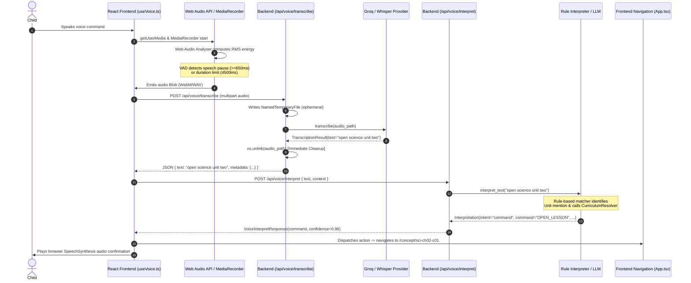
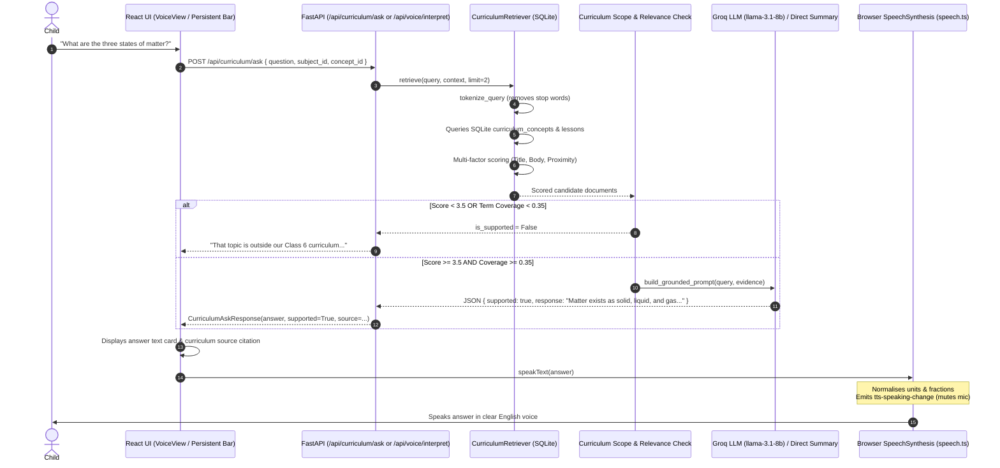
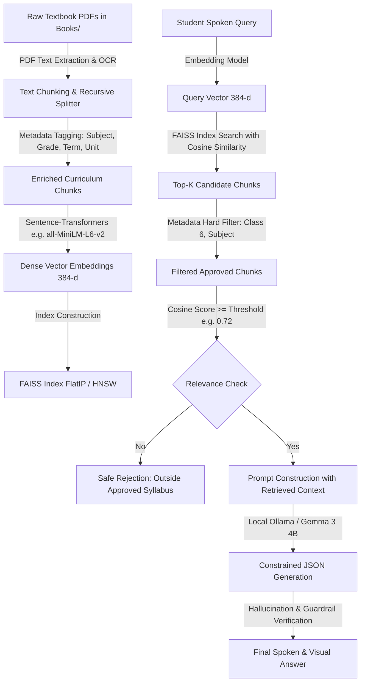
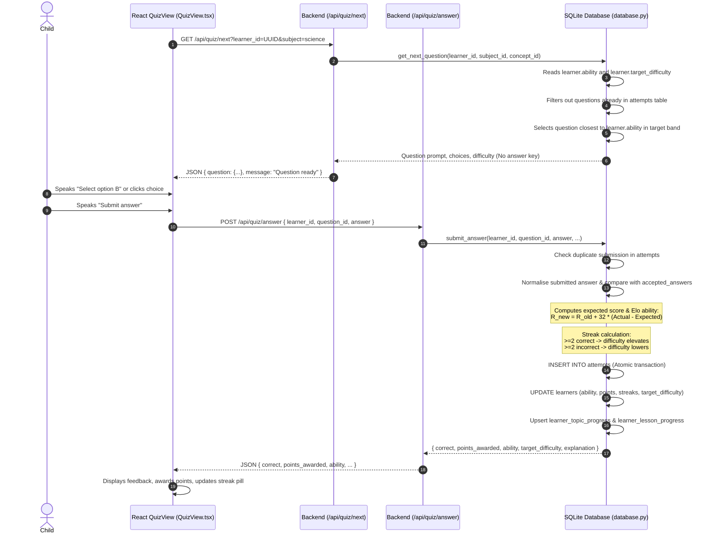
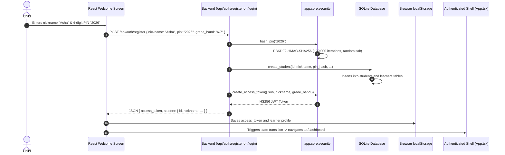

# Voice2Learn — End-to-End Technical Workflows

This document traces the complete execution paths of Voice2Learn's core workflows through the codebase. It details exact files, functions, API routes, data structures, and failure recovery mechanisms, with Mermaid sequence diagrams.

---

## Workflow A: Voice Command Execution

This workflow traces a hands-free navigation command (e.g., *"Open Science Unit 2"*, *"Show my progress"*, or *"Next concept"*).

### Technical Step-by-Step Breakdown:
1. **Microphone Capture:** `frontend/src/useVoice.ts` requests browser permission via `navigator.mediaDevices.getUserMedia({ audio: { echoCancellation: true, noiseSuppression: true, autoGainControl: true } })`.
2. **Real-Time Voice Activity Detection (VAD):** An `AudioContext` with an `AnalyserNode` (`fftSize = 512`) calculates root-mean-square (RMS) energy in `monitorSilence()`. Ambient background noise is calibrated during the first 300ms. Once speech is detected (`rms >= dynamicThreshold`), a 650ms continuous silence (`SILENCE_DURATION_MS`) triggers `next.stop()`.
3. **Audio Upload:** The recorded audio blob is packaged into a `FormData` payload and POSTed to `/api/voice/transcribe` (`frontend/src/api.ts:133`).
4. **Ephemeral Transcription:** In `backend/app/api/routes/voice.py:44`, the audio stream is written to a POSIX `NamedTemporaryFile`. The configured provider (`GroqWhisperProvider` or `FasterWhisperProvider`) transcribes the file. In a guaranteed `finally:` block, `os.unlink()` removes the temporary audio file.
5. **Deterministic Command Classification:** The transcribed string is passed to `backend/app/voice/interpreter.py:interpret_text()`. Text is normalised (lowercased, punctuation removed). The command parser checks:
   - Command dictionary (`COMMANDS`, `ALIASES`)
   - Choice pattern regexes (`SELECT_OPTION_A`, etc.)
   - Politeness prefix stripping (*"Can you please open..."*)
   - SequenceMatcher string similarity (Levenshtein distance ratio >= 0.84 with 0.04 margin).
6. **Optional Contextual LLM Fallback:** If the deterministic interpreter returns `intent: unknown`, `backend/app/voice/understanding.py:understand()` sends a structured prompt with the current route, recent turns, and an allowlist of 26 valid commands. If confidence is below 0.7 or the command is invalid on the current screen (e.g., trying to submit a quiz answer from the Dashboard), the command is rejected with a clarification prompt.
7. **Frontend Action Dispatch:** `frontend/src/components/voice/VoiceStatusBar.tsx` receives the validated command and dispatches the corresponding navigation event via `react-router-dom`'s `useNavigate()`.

---

## Workflow B: Educational Question Answering

This workflow traces a student asking an academic question (e.g., *"What is evaporation?"*, *"Why do sea turtles travel?"*).

### Technical Step-by-Step Breakdown:
1. **Input Submission:** Question text arrives either via voice transcription or text entry in `frontend/src/pages/VoiceView.tsx` or `frontend/src/components/voice/VoiceStatusBar.tsx`.
2. **Query Normalisation & Anaphora Resolution:** In `backend/app/qa/assistant.py:168`, follow-up queries containing pronouns (e.g., *"Why does it melt?"*) are enriched with the active screen's concept or chapter title (e.g., *"States of Matter Why does it melt?"*).
3. **Curriculum Retrieval:** `CurriculumRetriever.retrieve()` in `backend/app/qa/retriever.py:97` tokenises the search query, excludes stop words, and scores all SQLite curriculum concepts and seeded lessons:
   - Exact title match: +12.0
   - Exact body phrase: +7.0
   - Token in title: +3.0 per term
   - Token in summary/key points: +1.5 per term
   - Term coverage bonus: `coverage * 4.0`
   - Active screen/concept proximity boost: +4.0
4. **Relevance Thresholding & Guardrail:** The top candidate must achieve `score >= 3.5` and `coverage >= 0.35`. If it fails, the query is classified as unsupported and receives `OUT_OF_SCOPE_MESSAGE` without calling an LLM.
5. **Grounded Answer Synthesis:**
   - **Online Mode:** The retrieved text chunks are formatted into a strict system prompt instructing `llama-3.1-8b-instant` or `gemma3:4b` to answer in under 35 words using only the supplied facts.
   - **Offline / LLM-Failure Fallback:** If the LLM provider times out or is unconfigured, `generate_direct_summary_answer()` extracts the most relevant stored key point or summary directly from the SQLite database.
6. **Spoken Output & Acoustic Echo Gate:** The answer is rendered in the UI. `frontend/src/speech.ts:speakText()` passes the text through `normalizeEducationalText()` (converting `1/2` to *"one half"*, `km/h` to *"kilometers per hour"*, etc.) and emits a `tts-speaking-change` event. The voice listener immediately suspends recording to prevent the computer's speaker from triggering the microphone.

---

## Workflow C: Proposed Future RAG Pipeline (Planned / Not Implemented)

> [!NOTE]
> This section details the planned architecture for expanding Voice2Learn to multi-term and multi-grade curricula. It is **not currently implemented** in the repository.

---

## Workflow D: Quiz & Adaptive Learning Engine

This workflow traces question retrieval, answer evaluation, Elo-based ability adjustment, and database persistence.

### Detailed Elo Rating Mathematics:
The ability update implemented in `backend/app/db/database.py:772` is:
$$E = \frac{1}{1 + 10^{\frac{R_{\text{question}} - R_{\text{learner}}}{400}}}$$
$$R_{\text{new}} = R_{\text{learner}} + K \times (S - E)$$
Where:
* $R_{\text{learner}}$ is the learner's current ability rating (defaults to 1000.0).
* $R_{\text{question}}$ is the static calibrated difficulty rating of the question (e.g., Easy = 900, Medium = 1000, Hard = 1100).
* $E$ is the expected probability of the student answering correctly.
* $S$ is the actual outcome: $1.0$ for correct, $0.0$ for incorrect.
* $K = 32$ is the sensitivity factor.

---

## Workflow E: Learner Onboarding & Session Lifecycle

